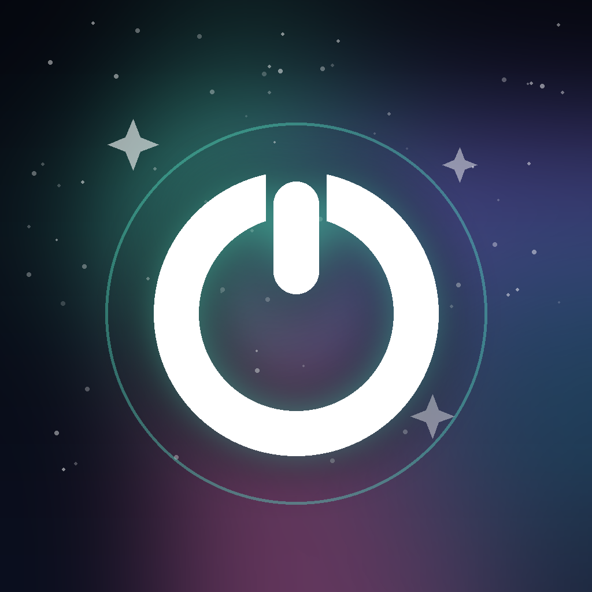
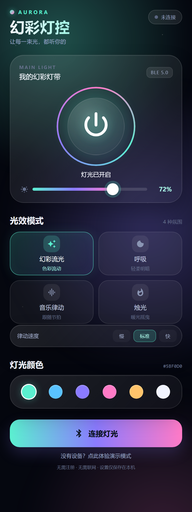

# AURORA 幻彩灯控

一个**无注册、无登录、无广告**的 Android 蓝牙幻彩灯控制 App。仅联网检查 GitHub 更新与下载新版本；通过 BLE 连接灯带，控制开关、亮度、颜色、光效与速度。

源码是**原生 Java 8 + 标准 Gradle 工程**，可以直接用 Android Studio 打开、调试和修改。

- **安装包**：[`dist/AuroraLight-v1.1.1.apk`](dist/AuroraLight-v1.1.1.apk)
- **源码包**：[`dist/AuroraLight-v1.1.1-source.zip`](dist/AuroraLight-v1.1.1-source.zip)
- **使用手册**：[`docs/使用手册.md`](docs/使用手册.md)
- **BLE 协议规范**：[`docs/BLE协议规范.md`](docs/BLE协议规范.md)
- **ESP32 固件烧录指南**：[`docs/固件烧录指南.md`](docs/固件烧录指南.md)
- **开发与构建说明**：[`docs/开发与构建说明.md`](docs/开发与构建说明.md)
- **测试与验证报告**：[`docs/测试与验证报告.md`](docs/测试与验证报告.md)
- **自动更新说明**：[`docs/自动更新说明.md`](docs/自动更新说明.md)
- **更新日志**：[`CHANGELOG.md`](CHANGELOG.md)
- **PDF 合集**：[`docs/AuroraLight-Manual-v1.1.1.pdf`](docs/AuroraLight-Manual-v1.1.1.pdf)
- **ESP32 参考固件**：[`firmware/aurora_light_esp32/aurora_light_esp32.ino`](firmware/aurora_light_esp32/aurora_light_esp32.ino)



> 自动更新地址已配置为 `https://l2197096277-pixel.github.io/RGB_APP/update.json`。首次安装后，后续 GitHub Actions 发布的新版本会弹窗更新；详见 [自动更新说明](docs/自动更新说明.md)。

---

## 功能

- 扫描附近的 BLE 灯带，按信号强度排序，优先标记 `AuroraLight-*`
- 一键连接，自动同步开关 / 亮度 / 颜色 / 光效 / 速度
- 大尺寸圆形总开关，带呼吸光晕与渐变扫光
- 亮度 0–100% 滑块
- 四种光效：流光跑马、呼吸、律动、火焰
- 九种协议颜色：红、橙、黄、绿、青、蓝、紫、白、品红
- 三档律动速度
- 连接状态胶囊：未连接 / 连接中 / 已连接 / 演示模式
- 记住上次连接的灯带地址，启动时自动连接
- 启动检查 GitHub 更新，弹窗下载并拉起系统安装
- 无硬件也可进入演示模式，完整体验 UI
- **三页界面**：控制 / 光效 / 我的，支持左右滑动和底部切换
- 未连接蓝牙时，所有控制按钮提示先连接；总开关未开启时提示先开灯
- 关灯后所有高光熄灭、亮度归 0
- 亮度拖动时实时发码，松手后再补发 3 次
- 模式短按开启、再按关闭；颜色只在光效关闭时可选，再次点击当前颜色关闭颜色
- 亮灯数量默认 1 个，`−`/`+` 直接发送 `11 07`；中间数字可点击输入 0–255
- **只发送**：不读取、不订阅设备状态
- 新增自检按钮（`0xFF`）
- 新增自定义灯光页：输入灯珠总数，逐颗点亮/关闭，最多 255 颗
- 新增 RGB 灯带启动动画（约 1.25 秒）
- 新增“一键关闭”按钮
- **开发者模式**：在“我的”页面长按版本号进入/退出，底部显示 App 发出的十六进制码
- 普通指令连续发送 3 次，间隔 100ms（0x07 相对数量例外）
- 所有设置保存在本机，无账号、无云端

## 界面

主界面由自绘极光背景、玻璃拟态卡片、渐变文字和自定义控件组成；没有使用 Material 组件库，APK 约 **236 KB**。



> 上图为与实现共用同一视觉规范的设计预览，非真机截图；实际 Android 渲染会因机型、字体和状态栏高度略有差异。

## 安装

1. 把 `dist/AuroraLight-v1.1.1.apk` 发送到 Android 手机。
2. 点击安装，首次需允许“安装未知应用”。
3. 打开 App，授予“附近的设备”权限（Android 11 及以下还需定位权限和定位开关）。
4. 给灯带通电，点“连接灯光”，选择 `AuroraLight-XXXX`。

```bash
adb install -r dist/AuroraLight-v1.1.1.apk
```

## 协议速览

| 项 | 值 |
|---|---|
| Service | `0000BBB0-0000-1000-8000-00805F9B34FB`（16 位 `0xBBB0`） |
| Control（手机→灯） | `0000BBB1-0000-1000-8000-00805F9B34FB`（16 位 `0xBBB1`，Write / Write NR） |
| Status（灯→手机） | `0000BBB2-0000-1000-8000-00805F9B34FB`（16 位 `0xBBB2`，Notify） |
| Info（可选） | `0000BBB3-0000-1000-8000-00805F9B34FB`（16 位 `0xBBB3`，Read） |
| 设备名 | `AuroraLight-XXXX` |
| 帧 | `11 \| CMD \| LEN \| DATA \| CHECKSUM` |
| 校验 | 前面所有字节累加，取低 8 位 |
| 命令 | `01` 开关、`02` 跑马、`03` 呼吸、`04` 火焰、`05` 律动、`06` 关闭光效、`07` 数量±1、`08` 颜色/关色、`10` 亮度、`11` 一键关闭、`12` 自定义单灯、`FF` 自检；扩展 `0A` 速度、`0B` 查询、`0F` 同步 |

完整字段、示例帧和固件实现见 [BLE 协议规范](docs/BLE协议规范.md)。

## 重要兼容性说明

App 使用**中科蓝讯 RGB 协议**。手机是主机，灯带是从机；灯带固件必须：

1. 提供 `0xBBB0` 服务，以及 `0xBBB1` / `0xBBB2` 特征值；
2. 按 `11 | CMD | LEN | DATA | CHECKSUM` 帧格式解析并执行命令；
3. 广播 BBB0 不是连接前提，但建议广播，便于 App 识别和排序。

因此它**不会直接兼容**市面上 UUID 和指令都不同的商业灯带。若你的灯带是可编程控制器（ESP32 等），可烧录 [`firmware/aurora_light_esp32`](firmware/aurora_light_esp32/) 中的参考固件，或按协议适配现有固件。没有硬件时可用 App 内的演示模式。

## 用 Android Studio 开发（推荐）

这是一个标准 Gradle Android 工程，可以直接用 Android Studio 打开、断点调试、修改界面和重新运行。

1. 安装 **Android Studio**（自带 JDK 17）与 **Android SDK 35**。
2. `File → Open`，选择本目录 `aurora-light`。
3. 等待 Gradle Sync。首次会下载 Gradle 8.9 和 Android Gradle Plugin 8.7.3。
4. 手机开启 USB 调试，连接电脑，点右上角 **Run ▶**。
5. 没接手机时也可以先用 App 内的演示模式看界面。

> Debug 和 Release 都使用项目签名 `keystore/aurora-release.jks`，所以 Android Studio 直接运行也能覆盖安装现有 APK；正式发版前记得提升 `versionCode`。

### 代码入口

- 主界面与按钮逻辑：[`MainActivity.java`](app/src/main/java/com/aurora/light/MainActivity.java)
- 蓝牙扫描/连接/写指令：[`AuroraBleManager.java`](app/src/main/java/com/aurora/light/AuroraBleManager.java)
- UUID、指令、校验和：[`AuroraProtocol.java`](app/src/main/java/com/aurora/light/AuroraProtocol.java)
- 布局：[`activity_main.xml`](app/src/main/res/layout/activity_main.xml)
- 颜色与文字：[`colors.xml`](app/src/main/res/values/colors.xml)、[`strings.xml`](app/src/main/res/values/strings.xml)
- 版本号与签名：[`app/build.gradle`](app/build.gradle)、[`keystore.properties`](keystore.properties)

### 命令行构建（不打开 Android Studio）

```powershell
.\gradlew.bat test
.\gradlew.bat assembleDebug
.\gradlew.bat assembleRelease
```

产物：

```text
app\build\outputs\apk\debug\app-debug.apk
app\build\outputs\apk\release\app-release.apk
app\build\reports\tests\testDebugUnitTest\index.html
```

首次构建需要联网下载 Gradle/AGP 依赖。详细步骤和测试清单见 [开发与构建说明](docs/开发与构建说明.md)。

### 用 VS Code 开发

VS Code 可以打开、编辑、编译、安装和启动 App，但不是完整的 Android IDE；**断点调试 Android 界面/BLE 仍建议用 Android Studio**。

1. 用 VS Code 打开项目根目录 `aurora-light`。
2. 安装推荐扩展：Java Extension Pack、Gradle for Java（打开项目时 VS Code 会提示）。
3. 按 `Ctrl+Shift+B` 构建 Debug 包。
4. `Terminal → Run Task` 选择：
   - `Android: Build Debug`
   - `Android: Test`
   - `Android: Build + Install + Launch`
   - `Android: Logcat`
5. 任务脚本会自动寻找 JDK/SDK；找不到时设置 `JAVA_HOME`、`ANDROID_HOME`，或按脚本提示配置。

VS Code 配置在 [`.vscode/tasks.json`](.vscode/tasks.json)，环境探测和 Gradle 调用在 [`tools/vscode-gradle.ps1`](tools/vscode-gradle.ps1)。

> 直接按 F5 不会启动 Android App，因为 VS Code 没有内置 Android 调试器；请用上面的任务，或使用 Android Studio 的 Run ▶。

### 无 Gradle 的备用构建

项目仍保留 `build.ps1`，适合没有 Android Studio、只想用命令行出包的场景；依赖 JDK 17、Android SDK 35 和 Python 3：

```powershell
powershell -NoProfile -ExecutionPolicy Bypass -File .\build.ps1 `
  -Python "C:\path\to\python.exe"
```

## 隐私

- 仅使用 `INTERNET` 检查 GitHub 更新和下载 APK，不上传个人信息
- 无账号、无手机号、无广告、无统计 SDK
- 不读取位置（`neverForLocation`）；Android 11 及以下的定位权限仅用于系统允许 BLE 扫描
- 设置只写入本机 `SharedPreferences`

## 已知限制

- 未在真实灯带上完成硬件在环测试；协议与参考固件需按你的灯带实际验证
- 单设备连接，无多灯分组、定时、OTA
- 自动连接使用上次保存的 MAC；如果设备随机化 MAC 或不在附近，需要手动扫描
- BLE 不配对、不加密，不适合门锁等安全场景

## 目录

```
aurora-light/
├─ app/                 Android 源码、资源、JUnit 测试
├─ gradle/              Gradle wrapper
├─ .vscode/             VS Code 构建/安装/日志任务
├─ firmware/            ESP32 参考固件
├─ docs/                使用手册、协议、开发文档
├─ tools/               图标生成、dex 注入、VS Code 环境脚本
├─ keystore/            项目签名密钥（务必保管）
├─ keystore.properties  签名配置（请勿公开）
├─ build.gradle         根构建脚本
├─ settings.gradle      Gradle 工程配置
├─ build.ps1            无 Gradle 的备用构建
├─ dist/                已签名 APK 与文档包
└─ assets/              图标源文件
```

---

版本 v1.1.1 · 2026-11 · Android 6.0+

